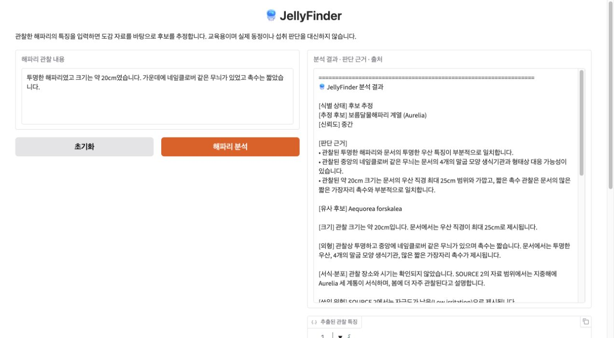

# 🪼 JellyFinder

관찰한 해파리의 특징을 자연어로 입력하면 **국문·영문 PDF 도감을 검색해 후보와 판단 근거, 실제 출처를 보여주는** 교육용 RAG 프로젝트입니다.

> “투명하고 약 20cm였어요. 가운데 네잎클로버 같은 무늬가 있었고 촉수는 짧았습니다.”

실제 실행 예시는 **보름달물해파리 계열(Aurelia), 신뢰도 중간**을 반환했습니다.
[전체 분석 출력](docs/sample-output.txt)에서 판단 근거와 페이지별 인용을 볼 수 있습니다.



## 주요 구현

- **국·영문 혼합 검색:** 벡터 검색과 BM25 순위를 결합하고 종별 원문을 복원합니다.
- **구조화된 출력:** Pydantic으로 관찰 특징, 후보, 주장별 인용을 관리합니다.
- **근거 검증:** 종 ID·학명·인용 구절을 코드로 검사한 뒤, 별도 LLM 호출로 의미를 검토합니다. 실패하면 한 번 수정·재검증하고 다시 실패하면 판단을 보류합니다.
- **출처 추적:** 결과와 같은 실행에 사용한 문서·페이지·URL·해시를 함께 반환합니다.
- **평가와 데모:** 실제 API 평가, 제어된 실패 주입 회귀, Gradio UI를 제공합니다.

```text
관찰 입력 → 특징 추출 → 국·영문 질의
                        ↓
PDF → 종별 문서 → 청크·임베딩 → 벡터 검색 + BM25
                                      ↓
                         후보 생성 → 인용 검사 → 의미 검토
                                      ↓
                              후보와 출처 / 판단 보류
```

## 실행 검증

**2026-09-30, Python 3.12.13의 새 가상환경·새 커널에서 실제 실행했습니다.**

| 검증 항목 | 결과 |
|---|---:|
| 설치 후 `pip check` | 통과 |
| 노트북 코드 셀 순차 실행 | 29/29, 오류 0 |
| 실제 기능 사례 | 12/12 PASS |
| 오프라인 실패 주입 회귀 | 32/32 PASS |
| 실제 의미 검토 회귀 | 1/1 PASS |
| 실제 모델·제어 입력 경계 검사 | 3/3 PASS |
| Gradio 브라우저 확인 | 6/6 PASS |

노트북 실행 **117.05초**, 별도 전체 평가 **257.45초**가 걸렸습니다. 환경 설치와 브라우저 수동 확인 시간은 제외했습니다.
선정 사례의 통과 기록이며 전체 종 정확도가 아닙니다. 응답과 시간은 실행마다 달라질 수 있습니다.

[사례별 결과와 실행 환경](docs/execution-report.md) · [검증 JSON](docs/validation-latest.json)

## 파일 구성

```text
jellyfinder.ipynb                 설명, 핵심 RAG 코드, 대표 실행 출력
requirements.txt                 핵심 패키지
requirements-dev.txt             Jupyter와 평가 도구
requirements-ui.txt              선택형 Gradio UI
requirements-lock.txt            검증한 macOS 환경의 전체 설치 버전
tests/validate_notebook.py       같은 노트북 커널에서 실행하는 전체 평가
docs/execution-report.md        최신 실행·사례별 평가 기록
docs/validation-latest.json      최신 검증 JSON
docs/gradio-demo.png             실제 Gradio 실행 화면
docs/sample-output.txt           최신 노트북 예시 출력
docs/validation-history.md       초기 정리 시 보관한 원본 평가 이력
```

## 실행 방법

Python 3.12와 로컬 Jupyter 기준입니다. 프로젝트 폴더에서 새 가상환경을 만드세요.

```bash
python3.12 -m venv .venv
source .venv/bin/activate
python -m pip install -r requirements-dev.txt
python -m pip check
python -m ipykernel install --user --name jellyfinder --display-name "Python (JellyFinder)"
python -m jupyterlab
```

Windows에서는 `.venv\Scripts\activate`로 가상환경을 활성화합니다. 이번 실제 검증 환경은 macOS이며 Windows·Colab은 재검증하지 않았습니다.
같은 macOS 환경의 전체 패키지 버전을 재현하려면 설치 목록으로 `requirements-lock.txt`를 사용할 수 있습니다. UI와 실행 검증 도구도 포함됩니다.

1. `jellyfinder.ipynb`를 열고 **Python (JellyFinder)** 커널을 선택합니다.
2. 위에서부터 **27절까지** 순서대로 실행합니다. 5절 설치 셀은 이미 설치했다면 건너뛸 수 있습니다.
3. 10절의 가려진 입력 칸에 API 키를 입력합니다. `OPENAI_API_KEY` 환경변수가 있으면 그대로 사용합니다.
4. 25절 `user_observation`을 바꾸고 25~26절을 실행해 새 결과를 확인합니다.

PDF는 첫 실행 때 `jellyfinder_data/`로 내려받고 원본 SHA-256을 확인합니다. 자료가 바뀌면 검증이 실패하므로 원문 변경과 파싱 규칙을 함께 확인해야 합니다.

**API 비용이 발생합니다.** 임베딩 생성, 중간 실습, 최종 분석에 API를 호출합니다. 전체 평가는 별도 실행입니다. 후보 추정에는 특징 추출·답변 생성·근거 검토가 필요하며 수정·재시도가 있으면 호출이 늘어납니다. 비용·토큰 사용량은 이번 검증에서 계측하지 않았습니다.

검증에 사용한 채팅 모델은 `gpt-5.6-luna`, 임베딩 모델은 `text-embedding-3-large`입니다.
채팅 모델을 바꾸려면 15절 실행 전에 `OPENAI_CHAT_MODEL` 환경변수를 설정하세요. JSON Schema 기반 Structured Output 호환성과 계정 접근 권한이 필요하며 변경 후 재평가해야 합니다.

## Gradio 데모

프로젝트 가상환경에 UI 패키지를 설치한 뒤, 준비된 노트북의 **30절**을 실행합니다.

```bash
python -m pip install -r requirements-ui.txt
```

관찰 내용을 입력하고 **해파리 분석**을 누르면 결과와 출처가 표시됩니다. 예시 선택만으로는 분석하지 않습니다.
기본값은 로컬 접속입니다. Colab 등 공개 공유가 필요한 환경에서는 UI 실행 전에 아래 값을 명시적으로 설정합니다.

```python
import os
os.environ["JELLYFINDER_SHARE"] = "true"
```

공유 중 다른 사람의 분석 요청도 실행 중인 커널의 API 키로 처리됩니다. 종료할 때는 `jellyfinder_demo.close()`를 실행합니다.
이번 검증은 공개 공유 없이 로컬 Chrome에서 진행했습니다.

## 전체 평가

노트북 27절까지 실행한 **같은 커널의 새 코드 셀**에서 실행합니다. 추가 API 호출이 발생합니다.

```python
%run -i tests/validate_notebook.py
```

이 파일은 노트북에 정의된 함수·객체를 검사하므로 독립적인 `python` 명령이나 `pytest`로 실행하는 테스트가 아닙니다.
오프라인 회귀 검사도 포함하지만 **전체 스크립트는 API 키가 필요합니다.**

결과는 `jellyfinder_data/jellyfinder_validation_latest.json`에 저장됩니다. 하나라도 실패하면 결과를 기록한 뒤 `AssertionError`를 발생시킵니다.
PDF 캐시, 새 평가 보고서, 가상환경과 비밀 설정은 `.gitignore`에서 제외합니다. 공개 문서에는 이번 실행 결과를 별도로 정리했습니다.

## 자료와 한계

- [국립수산과학원 PDF](https://download.nifs.go.kr/nfrdi/bbs/jellynews/1371459365520.pdf): 국내 종의 외형·출현 시기·분포 설명.
- [MED-JELLYRISK Malta 영문 가이드, 2015](https://ocean.mt/jellyfish/public/doc/Englishguide.pdf): 외형 식별 보조. 지중해 분포를 국내 분포로 취급하지 않습니다.

PDF 원본은 저장소에 포함하지 않고 출처에서 내려받습니다. 자료의 권리는 각 권리자에게 있습니다.
현재 버전은 PDF 기반이며 국립수산과학원 실시간 API는 사용하지 않습니다.

외형에 따른 교육용 후보 추정이며 실제 생물학적 동정이나 독성·섭취 판단을 대신하지 않습니다.
오래된 자료를 사용해 최신 출현 정보를 제공하지 않으며, LLM의 의미 검토에도 오류가 남을 수 있습니다.
식용 필드는 현재 자료 범위상 `자료에서 확인되지 않음`으로 제한합니다.
