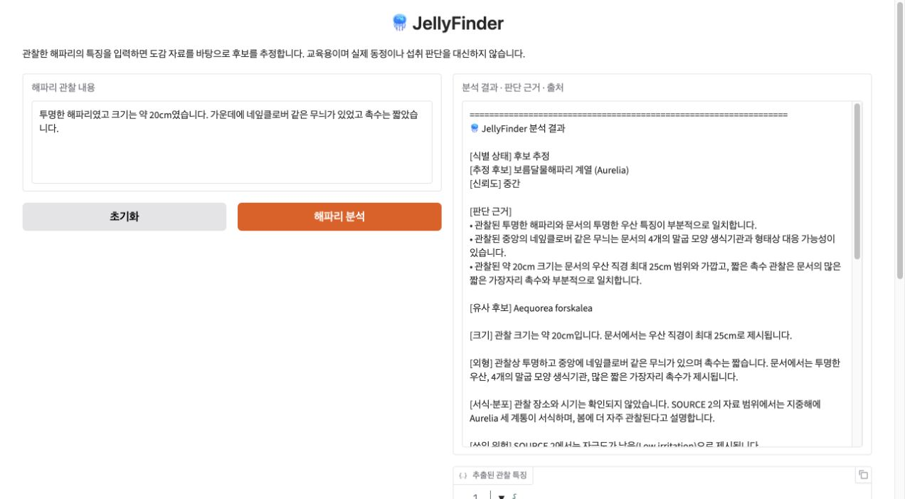

# 실행 검증 기록 — 2026-09-30

**전체 평가 통과.** 정리한 프로젝트를 새 Python 3.12.13 가상환경과 새 Jupyter 커널에서 실행했습니다.
검증 시각: `2026-09-30T13:33:43+09:00` (한국 시간).

## 실행 범위

| 항목 | 결과 |
|---|---|
| 패키지 설치·의존성 | 새 환경 설치 성공, `pip check` 통과 |
| PDF | 두 자료를 새로 다운로드, 각각 44페이지, 원본 SHA-256 일치 |
| 노트북 | 코드 셀 29/29 순차 실행, 오류 0 |
| 실제 기능 평가 | 12/12 PASS |
| 오프라인 회귀 | 32/32 PASS |
| 실제 의미 검토 회귀 | 1/1 PASS |
| 경계 검사 | 3/3 PASS |
| Gradio 브라우저 확인 | 6/6 PASS |

노트북 코드 셀 실행 합계는 **117.05초**, 별도 전체 평가는 **257.45초**였습니다.
환경 설치·API 키 입력·브라우저 수동 확인 시간은 이 합계에서 제외했습니다. 시간과 응답은 실행마다 달라질 수 있습니다.

## 실제 기능 사례

| 사례 | 결과 | 판정 | 시간 | LLM 호출 |
|---|---|---|---:|---:|
| 보름달·단위 변환 | 보름달물해파리 계열 | PASS | 24.63초 | 3회 |
| 노무라·넓은 특징 | 노무라입깃해파리 | PASS | 21.74초 | 3회 |
| 작은부레관·독립 사례 | 작은부레관해파리 | PASS | 44.61초 | 5회 |
| 야광원양·독립 사례 | 야광원양해파리 | PASS | 21.65초 | 3회 |
| 커튼원양·독립 사례 | 커튼원양해파리 | PASS | 18.26초 | 3회 |
| 유령·독립 사례 | 유령해파리 | PASS | 39.55초 | 5회 |
| 입방형·유사 후보 허용 | 라스톤입방해파리 | PASS | 18.95초 | 3회 |
| 흰 반점·촉수 부정 | Phyllorhiza punctata | PASS | 36.36초 | 5회 |
| 정보 부족 | 식별 보류 | PASS | 1.54초 | 1회 |
| 장소·시기만 | 식별 보류 | PASS | 1.39초 | 1회 |
| 빈 입력 | 식별 보류 | PASS | 0.01초 | 0회 |
| 해파리가 아닌 물체 | 식별 보류 | PASS | 8.88초 | 2회 |

실제 기능 12개 사례에서 기록한 LLM 호출은 합계 **34회**입니다.
이는 초기 실습, 임베딩, 의미 검토 회귀·경계 검사, 별도 UI 확인 호출을 포함하지 않습니다.
일부 사례는 첫 응답 검증 후 수정·재검증이 수행돼 호출이 늘었습니다. 비용·토큰 사용량은 계측하지 않았습니다.

## UI 확인

Chrome에서 로컬 Gradio 6.29.0 화면을 열어 다음 동작을 확인했습니다.

- 화면 로딩과 입력·결과 구성
- 빈 입력 안내
- 6,000자 초과 입력 거부
- 초기화로 입력과 이전 결과 제거
- 예시 선택 시 입력만 변경
- 분석 버튼을 통한 실제 API 응답, 추출 특징, 인용 출처 표시

대표 UI 입력은 투명한 몸체, 약 20cm, 중앙 네잎클로버 무늬, 짧은 촉수였습니다.
결과는 보름달물해파리 계열(Aurelia), 신뢰도 중간으로 표시됐습니다.
공개 공유 링크는 만들지 않았고 검증 후 UI와 커널을 종료했습니다.

## 실행 환경과 재현

- OS: macOS, Apple Silicon
- Python: 3.12.13
- Chat model: `gpt-5.6-luna`
- Embedding model: `text-embedding-3-large`
- Gradio: 6.29.0
- 핵심·개발·UI 설치 버전: 루트의 `requirements*.txt`
- 같은 macOS 환경의 전체 패키지 버전: `requirements-lock.txt`

실제 패키지 버전과 자료 해시는 [기계 판독용 검증 기록](validation-latest.json)에 있습니다.
원본의 Colab 환경에 있던 `jedi` 누락·requests 충돌은 이번 새 환경에서 재현되지 않았습니다.
Gradio import 중 선택적인 `IProgress` 위젯 관련 경고는 있었지만 UI 실행과 입력·출력 확인은 통과했습니다.

노트북의 설치 로그·중간 디버깅 출력·임시 UI iframe은 공개 파일에서 제외하고, 환경·자료 구성·특징 추출·최종 결과 출력을 남겼습니다.
전체 실행 노트북과 실행별 원문 스냅샷은 로컬의 Git 제외 경로 `jellyfinder_data/`에 있습니다.
코드 본문 SHA-256: `906fc54c2ac6a2d7d6949d64660146d435fa4e75d48c2a2e77651e0c1e234d42`. 평가 파일 SHA-256: `741cab763d47598680d8e9fd7b9ca954a711081ce872fd24f602b487cfe4a97e`.

## 결과의 한계

이번 통과는 선정 사례에 대한 기록이며, 전체 해파리 종의 정확도나 실제 생물 동정을 보증하지 않습니다.
일부 사례는 개발 예시와 겹치고, 의미 검토도 LLM이 수행합니다. 1회 실행의 통과가 모든 재실행의 통과를 보장하지 않습니다.
공개 PDF 기반 버전이며 국립수산과학원 실시간 API는 연결하지 않았습니다.
과거 원본 기록은 [초기 평가 이력](validation-history.md)으로 별도 보관합니다.
